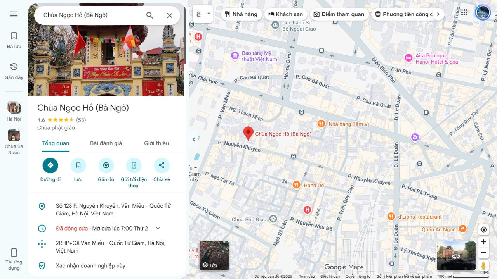
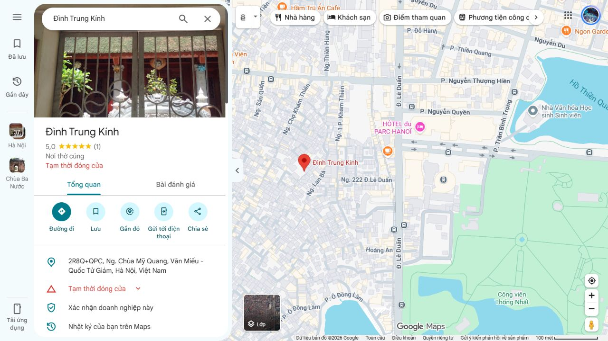

# Đối chiếu với Google Maps — 25/10/2026

**Đã tìm thấy listing tương ứng cho 32/32 địa điểm.** 25 điểm đang có tọa độ được so với pin của listing Google: khoảng cách giữa hai điểm từ **6,0 đến 69,6 m**, trung vị **17,4 m**. Không phát hiện điểm nào trong bộ 25 lệch trên 100 m so với listing đã chọn đúng khu vực.

**Bảy điểm trước đây chưa định vị đều có ứng viên Google. Các ứng viên được lưu riêng, chưa đưa vào bản đồ sản phẩm.** Bộ dữ liệu gốc vẫn có 25 pin và bảy tọa độ null.

Đây là đối chiếu thủ công thông tin hiển thị công khai trên Google Maps. Không gọi Places API, không tuyên bố Google chứng nhận dữ liệu, không xác minh cổng hoặc đường đi. Pin Google cũng có thể là điểm đại diện; khoảng cách hai pin không phải sai số trắc địa hoặc quãng đường đi bộ.

## Các khác biệt cần kiểm tra

| Địa điểm | Dữ liệu hiện tại | Google Maps / nguồn đối chiếu | Xử lý |
| --- | --- | --- | --- |
| Văn Miếu | Điểm tâm công báo | Pin Google cách 69,6 m | Giữ nguồn gốc; quần thể rộng, chưa xác nhận cổng. |
| Chùa Huy Văn | 13 ngõ Huy Văn | 34 Ngõ Văn Chương, Cổng sau | Phân biệt cổng trước/cổng sau. |
| Chùa Phổ Giác | 80 Ngô Sĩ Liên | Ngõ 56 Ngô Sỹ Liên | Chưa tự thay địa chỉ. |
| Chùa Linh Quang | 55 ngõ Văn Chương 2 | 1 Văn Chương 2 | Cần xác minh số nhà/lối vào. |
| Chùa Liên Hoa | Chỉ ghi khu Khâm Thiên | Google: 300 Ngõ Văn Chương; Đống Đa 360: 71 ngõ chùa Liên Hoa | Chưa chốt địa chỉ cổng. |
| Đền Trung Tả | 24 ngõ Trung Tả | 264 phố Khâm Thiên; pin cách 60,8 m | Ưu tiên kiểm tra thực địa. |

Nguồn bổ sung: [Đống Đa 360 — Đình Thanh Miến](https://www.dongda360.vn/chi_tiet_di_tich_danh_lam/dinh-thanh-mien.html) xác nhận số 20 ngõ Thanh Miến; mục địa điểm xung quanh ghi Chùa Linh Quang số 55 ngõ Văn Chương 2 và Đền Trung Tả số 24 ngõ Trung Tả. [Đống Đa 360 — Chùa Liên Hoa](https://www.dongda360.com.vn/chi_tiet_di_tich_danh_lam/chua-lien-hoa.html) ghi số 71 ngõ chùa Liên Hoa. [Thư viện Hà Nội](https://tracuu.ttvanhoavathuvien.hanoi.gov.vn/tai-lieu-chi-tiet/chua-tien-tich-o-phia-nam-kinh-thanh--nguyen-thi-hoa-249198.html) xác nhận Chùa Tiên Tích ở số 110 Lê Duẩn. Không dùng nhãn phường trên Google để tự thay địa giới hiện hành trong dữ liệu chuẩn.

## Hai trường hợp dễ khớp nhầm

- **Thổ Quan:** tìm tên ngắn ban đầu trả một listing cùng tên ở Hoài Đức, cách tọa độ app 12,8 km. Đã loại kết quả đó. Listing Đình Làng Thổ Quan trong khu Đống Đa cách điểm tâm app 9,9 m.
- **Trung Kính:** kết quả phổ biến Trung Kính Thượng/Hạ nằm ngoài khu dự án. Đã tìm được listing Đình Trung Kính trong ngõ Chùa Mỹ Quang, phù hợp dấu hiệu vị trí trong tài liệu bàn giao.
- Đồng thời loại kết quả **phố Y Miếu** khi chọn di tích **Y Miếu Thăng Long**, và loại **nhà hàng Hồ Văn** khi chọn hồ **Hồ Giám**.

## 25 điểm đang có tọa độ

| Địa điểm | Pin app WGS84 | Pin listing Google | Cách nhau | Nguồn Google |
| --- | --- | --- | ---: | --- |
| Văn Miếu – Quốc Tử Giám | 21.0287364, 105.8357716 | 21.0281175, 105.8356692 | 69.6 m | [Listing](https://www.google.com/maps/place/V%C4%83n+Mi%C3%AA%CC%81u+%E2%80%93+Qu%C3%B4%CC%81c+T%C6%B0%CC%89+Gia%CC%81m/@21.0281175,105.8356692,17z/data=!3m1!4b1!4m6!3m5!1s0x3135ab9926e7bd67:0x580e078874d5df1e!8m2!3d21.0281175!4d105.8356692!16zL20vMGI5aGp6?entry=ttu&g_ep=EgoyMDI2MTAyMC4wIKXMDSoASAFQAw%3D%3D) |
| Hồ Văn – Gò Kim Châu | 21.0265142, 105.8352160 | 21.0265502, 105.8353596 | 15.4 m | [Listing](https://www.google.com/maps/place/H%E1%BB%93+Gi%C3%A1m/@21.0265502,105.8308535,17z/data=!4m10!1m2!2m1!1zSOG7kyBWxINuIFbEg24gTWnhur91!3m6!1s0x3135ab995471714f:0xea60b879bb5b4325!8m2!3d21.0265502!4d105.8353596!15sChVI4buTIFbEg24gVsSDbiBNaeG6v3VaFyIVaOG7kyB2xINuIHbEg24gbWnhur91kgEEbGFrZZoBRENpOURRVWxSUVVOdlpFTm9kSGxqUmpsdlQyMXNWVk5FU1hSYVNHeEVaRE5rV1ZONlFucGlNM0ExVld4Uk5WUkZSUkFC4AEA-gEFCLwJECw!16s%2Fg%2F1tg4yw_p?entry=ttu&g_ep=EgoyMDI2MTAyMC4wIKXMDSoASAFQAw%3D%3D) |
| Chùa Bà Nành (Tiên Phúc tự) | 21.0290142, 105.8366049 | 21.0289840, 105.8366669 | 7.3 m | [Listing](https://www.google.com/maps/place/Ch%C3%B9a+B%C3%A0+N%C3%A0nh,+27+P.+V%C4%83n+Mi%E1%BA%BFu,+V%C4%83n+Mi%E1%BA%BFu+-+Qu%E1%BB%91c+T%E1%BB%AD+Gi%C3%A1m,+H%C3%A0+N%E1%BB%99i,+Vi%E1%BB%87t+Nam/@21.0289506,105.8366565,17z/data=!3m1!4b1!4m6!3m5!1s0x3135ab991e6b609b:0xba45a1058caf388f!8m2!3d21.028984!4d105.8366669!16s%2Fg%2F120wl82g?entry=ttu&g_ep=EgoyMDI2MTAyMC4wIKXMDSoASAFQAw%3D%3D) |
| Chùa Ngọc Hồ (Bà Ngô) | 21.0290142, 105.8374383 | 21.0287579, 105.8374572 | 28.6 m | [Listing](https://www.google.com/maps/place/Ch%C3%B9a+Ng%E1%BB%8Dc+H%E1%BB%93+(B%C3%A0+Ng%C3%B4)/@21.0287579,105.8374572,17z/data=!3m1!4b1!4m6!3m5!1s0x3135ab990401d145:0xe168f4c2ef31bf7b!8m2!3d21.0287579!4d105.8374572!16s%2Fg%2F1229w8hs?entry=ttu&g_ep=EgoyMDI2MTAyMC4wIKXMDSoASAFQAw%3D%3D) |
| Y Miếu | 21.0270697, 105.8396605 | 21.0270619, 105.8394839 | 18.3 m | [Listing](https://www.google.com/maps/place/Y+Mi%E1%BA%BFu+Th%C4%83ng+Long/@21.0270619,105.8304717,16z/data=!4m10!1m2!2m1!1zRGkgdMOtY2ggWSBNaeG6v3UgVGjEg25nIExvbmcgSMOgIE7hu5lp!3m6!1s0x3135ab98e154a4d5:0x1ddfc0d4927e3e!8m2!3d21.0270619!4d105.8394839!15sCidEaSB0w61jaCBZIE1p4bq_dSBUaMSDbmcgTG9uZyBIw6AgTuG7mWlaKSInZGkgdMOtY2ggeSBtaeG6v3UgdGjEg25nIGxvbmcgaMOgIG7hu5lpkgERaGVyaXRhZ2VfYnVpbGRpbmeaASNDaFpEU1VoTk1HOW5TMFZKUTBGblNVUXRkV1V6YjBSM0VBReABAPoBBAgAECs!16s%2Fg%2F11c1rspkqg?entry=ttu&g_ep=EgoyMDI2MTAyMC4wIKXMDSoASAFQAw%3D%3D) |
| Chùa Huy Văn | 21.0229031, 105.8327160 | 21.0228633, 105.8327643 | 6.7 m | [Listing](https://www.google.com/maps/place/Ch%C3%B9a+Huy+V%C4%83n/@21.0228633,105.8327643,17z/data=!3m1!4b1!4m6!3m5!1s0x3135ab004038ebe7:0xd8a01cdc6376f24!8m2!3d21.0228633!4d105.8327643!16s%2Fg%2F11xz2v_0xk?entry=ttu&g_ep=EgoyMDI2MTAyMC4wIKXMDSoASAFQAw%3D%3D) |
| Đền Văn Chỉ | 21.0234587, 105.8329938 | 21.0235878, 105.8330439 | 15.3 m | [Listing](https://www.google.com/maps/place/%C4%90%E1%BB%81n+V%C4%83n+Ch%E1%BB%89/@21.0235878,105.8330439,17z/data=!3m1!4b1!4m6!3m5!1s0x3135ab005c324f5b:0x14c0018f09e3015!8m2!3d21.0235878!4d105.8330439!16s%2Fg%2F11w7pk9816?entry=ttu&g_ep=EgoyMDI2MTAyMC4wIKXMDSoASAFQAw%3D%3D) |
| Chùa Phổ Giác | 21.0265142, 105.8379938 | 21.0264241, 105.8380677 | 12.6 m | [Listing](https://www.google.com/maps/place/Ch%C3%B9a+Ph%E1%BB%95+Gi%C3%A1c/@21.0264097,105.8380548,17z/data=!4m10!1m2!2m1!1zQ2jDuWEgUGjhu5UgR2nDoWMgSMOgIE7hu5lp!3m6!1s0x3135ab9986a60a2f:0xca05cf0c7c3e14fd!8m2!3d21.0264241!4d105.8380677!15sChtDaMO5YSBQaOG7lSBHacOhYyBIw6AgTuG7mWlaHSIbY2jDuWEgcGjhu5UgZ2nDoWMgaMOgIG7hu5lpkgEPYnVkZGhpc3RfdGVtcGxlmgEjQ2haRFNVaE5NRzluUzBWSlEwRm5TVU4wYkVwcFFVVlJFQUXgAQD6AQUIyAQQLg!16s%2Fg%2F11g_swc5d?entry=ttu&g_ep=EgoyMDI2MTAyMC4wIKXMDSoASAFQAw%3D%3D) |
| Đài tưởng niệm Khâm Thiên | 21.0187364, 105.8385492 | 21.0187806, 105.8385830 | 6.0 m | [Listing](https://www.google.com/maps/place/%C4%90%C3%A0i+T%C6%B0%E1%BB%9Fng+Ni%E1%BB%87m+Kh%C3%A2m+Thi%C3%AAn/@21.0187806,105.838583,17z/data=!3m1!4b1!4m6!3m5!1s0x3135ab8530000001:0xbb83feb031386534!8m2!3d21.0187806!4d105.838583!16s%2Fg%2F11c1s7067g?entry=ttu&g_ep=EgoyMDI2MTAyMC4wIKXMDSoASAFQAw%3D%3D) |
| Đình làng Trung Tự | 21.0120697, 105.8382714 | 21.0119944, 105.8380717 | 22.4 m | [Listing](https://www.google.com/maps/place/%C4%90%C3%ACnh+l%C3%A0ng+Trung+t%E1%BB%B1/@21.0119944,105.8380717,17z/data=!3m1!4b1!4m6!3m5!1s0x3135ab5759a1645f:0x58e52da210933a43!8m2!3d21.0119944!4d105.8380717!16s%2Fg%2F11n2bn4gj5?authuser=0&hl=vi&entry=ttu&g_ep=EgoyMDI2MTAyMC4wIKXMDSoASAFQAw%3D%3D) |
| Đền Kim Liên (Đình Kim Liên) | 21.0106808, 105.8382714 | 21.0106528, 105.8382111 | 7.0 m | [Listing](https://www.google.com/maps/place/%C4%90%E1%BB%81n+-+%C4%90%C3%ACnh+Kim+Li%C3%AAn/@21.0106528,105.8382111,17z/data=!3m1!4b1!4m6!3m5!1s0x3135ab87a5c572b3:0xa47d211e17e9a2d0!8m2!3d21.0106528!4d105.8382111!16s%2Fg%2F121z222s?entry=ttu&g_ep=EgoyMDI2MTAyMC4wIKXMDSoASAFQAw%3D%3D) |
| Đình Văn Hương | 21.0237364, 105.8354938 | 21.0236827, 105.8356211 | 14.5 m | [Listing](https://www.google.com/maps/place/%C4%90%C3%ACnh+V%C4%83n+H%C6%B0%C6%A1ng/@21.0236827,105.8356211,17z/data=!3m1!4b1!4m6!3m5!1s0x3135ab9b831236db:0x11a6ad8ade0e85b!8m2!3d21.0236827!4d105.8356211!16s%2Fg%2F11cs0d_wgq?entry=ttu&g_ep=EgoyMDI2MTAyMC4wIKXMDSoASAFQAw%3D%3D) |
| Chùa Phụng Thánh | 21.0173475, 105.8368826 | 21.0177664, 105.8367944 | 47.5 m | [Listing](https://www.google.com/maps/place/Ch%C3%B9a+Ph%E1%BB%A5ng+Th%C3%A1nh/@21.0177664,105.8367944,17z/data=!3m1!4b1!4m6!3m5!1s0x3135ab83ed25dddd:0x2151fdf4aea786d4!8m2!3d21.0177664!4d105.8367944!16s%2Fg%2F11gg64n8r0?entry=ttu&g_ep=EgoyMDI2MTAyMC4wIKXMDSoASAFQAw%3D%3D) |
| Đền Mẫu Sòng Sơn – Hà Nội | 21.0267920, 105.8341049 | 21.0269214, 105.8339475 | 21.8 m | [Listing](https://www.google.com/maps/place/%C4%90%E1%BB%81n+M%E1%BA%ABu+S%C3%B2ng+S%C6%A1n+-+H%C3%A0+N%E1%BB%99i/@21.0269214,105.8339475,17z/data=!3m1!4b1!4m6!3m5!1s0x3135ab75bcc5e649:0x13694cbe33108768!8m2!3d21.0269214!4d105.8339475!16s%2Fg%2F11jfcwhc2h?entry=ttu&g_ep=EgoyMDI2MTAyMC4wIKXMDSoASAFQAw%3D%3D) |
| Chùa Quang Minh | 21.0267919, 105.8396605 | 21.0268569, 105.8395071 | 17.5 m | [Listing](https://www.google.com/maps/place/Ch%C3%B9a+Quang+Minh_(+Thi%E1%BB%87n+nguy%E1%BB%87n+Tr%E1%BA%BB+H%C3%A0+N%E1%BB%99i+c%E1%BA%ADp+nh%E1%BA%ADt)/@20.9714364,105.8083593,13z/data=!4m10!1m2!2m1!1zQ2jDuWEgUXVhbmcgTWluaCA4IFkgTWnhur91IEjDoCBO4buZaQ!3m6!1s0x3135abb9ddca3d1b:0x759780453896e1f7!8m2!3d21.0268569!4d105.8395071!15sCiVDaMO5YSBRdWFuZyBNaW5oIDggWSBNaeG6v3UgSMOgIE7hu5lpWiciJWNow7lhIHF1YW5nIG1pbmggOCB5IG1p4bq_dSBow6AgbuG7mWmSAQ9idWRkaGlzdF90ZW1wbGWaAURDaTlEUVVsUlFVTnZaRU5vZEhsalJqbHZUMjFHVkdOdVpFMVRhMUphVFRJeFRWbFhlR0ZVTTJkMFUxWldlVkZ1WXhBQuABAPoBBAgAECg!16s%2Fg%2F11jff4bcgn?entry=ttu&g_ep=EgoyMDI2MTAyMC4wIKXMDSoASAFQAw%3D%3D) |
| Đình – Đền Lương Sử | 21.0256809, 105.8363271 | 21.0257366, 105.8361708 | 17.4 m | [Listing](https://www.google.com/maps/place/%C4%90%C3%ACnh+-+%C4%90%E1%BB%81n+L%C6%B0%C6%A1ng+S%E1%BB%AD/@21.0257366,105.8361708,17z/data=!3m1!4b1!4m6!3m5!1s0x3135ab9be0a335ef:0xda7af69e08e509b3!8m2!3d21.0257366!4d105.8361708!16s%2Fg%2F1tdmgyt0?entry=ttu&g_ep=EgoyMDI2MTAyMC4wIKXMDSoASAFQAw%3D%3D) |
| Chùa Linh Quang | 21.0226253, 105.8366049 | 21.0224685, 105.8365511 | 18.3 m | [Listing](https://www.google.com/maps/place/Chu%CC%80a+Linh+Quang/@21.0224685,105.8365511,17z/data=!3m1!4b1!4m6!3m5!1s0x3135ab9b12fc3565:0x5d9a2e66ddbda0f3!8m2!3d21.0224685!4d105.8365511!16s%2Fg%2F1jkvp6yh2?authuser=0&hl=vi&entry=ttu&g_ep=EgoyMDI2MTAyMC4wIKXMDSoASAFQAw%3D%3D) |
| Chùa Bụt Mọc | 21.0209586, 105.8343826 | 21.0211064, 105.8342817 | 19.5 m | [Listing](https://www.google.com/maps/place/Ch%C3%B9a+B%E1%BB%A5t+M%E1%BB%8Dc/@21.0211064,105.8342817,17z/data=!3m1!4b1!4m6!3m5!1s0x3135ab9cb0264ff9:0xaa494c78e8ecf3c3!8m2!3d21.0211064!4d105.8342817!16s%2Fg%2F1jkvpj486?entry=ttu&g_ep=EgoyMDI2MTAyMC4wIKXMDSoASAFQAw%3D%3D) |
| Chùa Liên Hoa | 21.0201253, 105.8368826 | 21.0200041, 105.8369620 | 15.8 m | [Listing](https://www.google.com/maps/place/Ch%C3%B9a+Li%C3%AAn+Hoa/@21.0013102,105.8338674,14z/data=!4m10!1m2!2m1!1zQ2jDuWEgTGnDqm4gSG9hIDcxIG5nw7UgTGnDqm4gSG9hIEjDoCBO4buZaQ!3m6!1s0x3135ab0005d9a273:0xda6a8bd202483482!8m2!3d21.0200041!4d105.836962!15sCitDaMO5YSBMacOqbiBIb2EgNzEgbmfDtSBMacOqbiBIb2EgSMOgIE7hu5lpkgEPYnVkZGhpc3RfdGVtcGxl4AEA!16s%2Fg%2F11yf8m9t56?entry=ttu&g_ep=EgoyMDI2MTAyMC4wIKXMDSoASAFQAw%3D%3D) |
| Chùa Linh Ứng | 21.0195698, 105.8338270 | 21.0195465, 105.8336580 | 17.7 m | [Listing](https://www.google.com/maps/place/Ch%C3%B9a+Linh+%E1%BB%A8ng/@21.0195465,105.833658,17z/data=!3m1!4b1!4m6!3m5!1s0x3135ab832215395f:0x3c34a040cd66c937!8m2!3d21.0195465!4d105.833658!16s%2Fg%2F1vnnfvyw?entry=ttu&g_ep=EgoyMDI2MTAyMC4wIKXMDSoASAFQAw%3D%3D) |
| Đền Trung Tả | 21.0198475, 105.8346604 | 21.0193472, 105.8344243 | 60.8 m | [Listing](https://www.google.com/maps/place/%C4%90%E1%BB%81n+Trung+T%E1%BA%A3/@21.0193472,105.8344243,17z/data=!3m1!4b1!4m6!3m5!1s0x3135ab8357295555:0xb3e8ceb08ddca753!8m2!3d21.0193472!4d105.8344243!16s%2Fg%2F11kj3f80fr?entry=ttu&g_ep=EgoyMDI2MTAyMC4wIKXMDSoASAFQAw%3D%3D) |
| Chùa Mỹ Quang | 21.0170697, 105.8391048 | 21.0171535, 105.8391992 | 13.5 m | [Listing](https://www.google.com/maps/place/Ch%C3%B9a+M%E1%BB%B9+Quang/@21.0171535,105.8391992,17z/data=!3m1!4b1!4m6!3m5!1s0x3135ab85a4a9513f:0x5fa8b82c6060d629!8m2!3d21.0171535!4d105.8391992!16s%2Fg%2F1pzs6jmyq?entry=ttu&g_ep=EgoyMDI2MTAyMC4wIKXMDSoASAFQAw%3D%3D) |
| Đình làng Thổ Quan | 21.0162364, 105.8346603 | 21.0161540, 105.8346961 | 9.9 m | [Listing](https://www.google.com/maps/place/%C4%90%C3%ACnh+L%C3%A0ng+Th%E1%BB%95+Quan/@21.016154,105.8346961,17z/data=!3m1!4b1!4m6!3m5!1s0x3135ab838b2d54a7:0x6100df49d22941e5!8m2!3d21.016154!4d105.8346961!16s%2Fg%2F1jkwghttq?entry=ttu&g_ep=EgoyMDI2MTAyMC4wIKXMDSoASAFQAw%3D%3D) |
| Đền Trung Phụng | 21.0154030, 105.8382714 | 21.0152945, 105.8382723 | 12.1 m | [Listing](https://www.google.com/maps/place/%C4%90%E1%BB%81n+Trung+Ph%E1%BB%A5ng,+Ng.+Ch%E1%BB%A3+Kh%C3%A2m+Thi%C3%AAn,+V%C4%83n+Mi%E1%BA%BFu+-+Qu%E1%BB%91c+T%E1%BB%AD+Gi%C3%A1m,+H%C3%A0+N%E1%BB%99i,+Vi%E1%BB%87t+Nam/@21.0152848,105.8382887,17z/data=!3m1!4b1!4m6!3m5!1s0x3135ab85ce467041:0x85a55609833639a0!8m2!3d21.0152945!4d105.8382723!16s%2Fg%2F11bvtf86k5?entry=ttu&g_ep=EgoyMDI2MTAyMC4wIKXMDSoASAFQAw%3D%3D) |
| Chùa Trung Tự | 21.0129030, 105.8363270 | 21.0129049, 105.8360797 | 25.7 m | [Listing](https://www.google.com/maps/place/Ch%C3%B9a+Trung+T%E1%BB%B1/@21.0129049,105.8360797,17z/data=!3m1!4b1!4m6!3m5!1s0x3135abf5418d1417:0xc0c83a418d802a87!8m2!3d21.0129049!4d105.8360797!16s%2Fg%2F11fz6s2_h5?entry=ttu&g_ep=EgoyMDI2MTAyMC4wIKXMDSoASAFQAw%3D%3D) |

## Bảy ứng viên mới — chưa nhập vào dữ liệu sản phẩm

| Địa điểm | Tọa độ ứng viên Google | Địa chỉ hiển thị | Nguồn |
| --- | --- | --- | --- |
| Đình Khâm Đức | 21.0175766, 105.8386924 | 74 Ng. Chợ Khâm Thiên, Văn Miếu - Quốc Tử Giám, Hà Nội, Việt Nam  | [Listing](https://www.google.com/maps/place/%C4%90%C3%ACnh+Kh%C3%A2m+%C4%90%E1%BB%A9c/@21.0175766,105.8386924,17z/data=!3m1!4b1!4m6!3m5!1s0x3135ab85141e0631:0xbe5a5174ffa45bae!8m2!3d21.0175766!4d105.8386924!16s%2Fg%2F11g8_3tn1k?entry=ttu&g_ep=EgoyMDI2MTAyMC4wIKXMDSoASAFQAw%3D%3D) |
| Đình Thanh Miến | 21.0294563, 105.8376179 | 2RHQ+Q2Q, Ng. Thanh Miến, Văn Miếu - Quốc Tử Giám, Hà Nội, Việt Nam  | [Listing](https://www.google.com/maps/place/%C4%90%C3%ACnh+Thanh+Mi%E1%BA%BFn/@21.0294563,105.8376179,17z/data=!3m1!4b1!4m6!3m5!1s0x3135ab98f90fe039:0x665e93c297bbaa18!8m2!3d21.0294563!4d105.8376179!16s%2Fg%2F11h04vln8?entry=ttu&g_ep=EgoyMDI2MTAyMC4wIKXMDSoASAFQAw%3D%3D) |
| Đền Đức Thánh Trần | 21.0264671, 105.8413571 | 100 Đ. Lê Duẩn, Văn Miếu - Quốc Tử Giám, Hà Nội, Việt Nam  | [Listing](https://www.google.com/maps/place/%C4%90%E1%BB%81n+%C4%90%E1%BB%A9c+Th%C3%A1nh+Tr%E1%BA%A7n/@21.0264671,105.8413571,17z/data=!3m1!4b1!4m6!3m5!1s0x3135abef39cb6b67:0xa458c37156350d0b!8m2!3d21.0264671!4d105.8413571!16s%2Fg%2F11h4fjy5yp?entry=ttu&g_ep=EgoyMDI2MTAyMC4wIKXMDSoASAFQAw%3D%3D) |
| Chùa Tiên Tích | 21.0262402, 105.8413884 | 110 Đ. Lê Duẩn, Văn Miếu - Quốc Tử Giám, Hà Nội, Việt Nam  | [Listing](https://www.google.com/maps/place/Ch%C3%B9a+Ti%C3%AAn+T%C3%ADch/@21.0262402,105.8413884,17z/data=!3m1!4b1!4m6!3m5!1s0x3135ab974e25c6ff:0x9fbc85deda607fd0!8m2!3d21.0262402!4d105.8413884!16s%2Fg%2F1yfh_jsxv?entry=ttu&g_ep=EgoyMDI2MTAyMC4wIKXMDSoASAFQAw%3D%3D) |
| Đền Khâm Đức (thờ Châu Đệ Tứ) | 21.0176355, 105.8387480 | 63 Ng. Chợ Khâm Thiên, Văn Miếu - Quốc Tử Giám, Hà Nội, Việt Nam  | [Listing](https://www.google.com/maps/place/%C4%90%E1%BB%81n+Kh%C3%A2m+%C4%90%E1%BB%A9c+-+th%E1%BB%9D+Ch%E1%BA%A7u+%C4%90%E1%BB%87+T%E1%BB%A9/@21.0176355,105.838748,17z/data=!3m1!4b1!4m6!3m5!1s0x3135ab0039c90633:0x6fb840a8fdc6952e!8m2!3d21.0176355!4d105.838748!16s%2Fg%2F11yjr68xd1?entry=ttu&g_ep=EgoyMDI2MTAyMC4wIKXMDSoASAFQAw%3D%3D) |
| Đình Trung Kính | 21.0169454, 105.8392717 | 2R8Q+QPC, Ng. Chùa Mỹ Quang, Văn Miếu - Quốc Tử Giám, Hà Nội, Việt Nam  | [Listing](https://www.google.com/maps/place/%C4%90%C3%ACnh+Trung+K%C3%ADnh/@21.0169454,105.8392717,17z/data=!3m1!4b1!4m6!3m5!1s0x3135abec41686d6b:0x7f0db5c35c997ddd!8m2!3d21.0169454!4d105.8392717!16s%2Fg%2F11h51cjyyh?entry=ttu&g_ep=EgoyMDI2MTAyMC4wIKXMDSoASAFQAw%3D%3D) |
| Đình Thái Kiều | 21.0157923, 105.8364920 | 84 Ng. 218 Ng. Chợ Khâm Thiên, Văn Miếu - Quốc Tử Giám, Hà Nội, Việt Nam  | [Listing](https://www.google.com/maps/place/%C4%90%C3%ACnh+Tha%CC%81i+Ki%C3%AA%CC%80u/@21.0512089,105.6583511,11z/data=!4m10!1m2!2m1!1zxJDDrG5oIFBo4bunIFRow6FpIEtp4buBdSBUcnVuZyBQaOG7pW5nIEjDoCBO4buZaQ!3m6!1s0x3135abe003a464d9:0x16de96effe8d5052!8m2!3d21.0157923!4d105.836492!15sCjHEkMOsbmggUGjhu6cgVGjDoWkgS2nhu4F1IFRydW5nIFBo4bulbmcgSMOgIE7hu5lpkgEPYnVkZGhpc3RfdGVtcGxl4AEA!16s%2Fg%2F11mp9y68yz?entry=ttu&g_ep=EgoyMDI2MTAyMC4wIKXMDSoASAFQAw%3D%3D) |

Đình Khâm Đức (số 74) và Đền Khâm Đức (số 63, thờ Chầu Đệ Tứ) có hai listing và hai pin rất gần nhau. Chưa khẳng định ranh giới cơ sở/cổng độc lập chỉ dựa trên Google. Đình Thanh Miến cần xác nhận cổng số 20; các ứng viên còn lại cần đối chiếu hồ sơ quản lý và thực địa trước khi nâng mức xác minh.

## Dữ liệu và chứng cứ

- [comparison.json](comparison.json): 32 dòng, tọa độ gốc, quan sát Google, độ lệch và ghi chú từng điểm.
- [candidate-pins.json](candidate-pins.json): bảy ứng viên tách riêng, cờ REVIEW_ONLY_DO_NOT_IMPORT_AUTOMATICALLY.
- [observations.json](observations.json): nhật ký các lần tìm kiếm, kể cả kết quả không khớp ban đầu. Khi tái tạo báo cáo, chọn lần đối chiếu có pin gần nhất theo thời gian cho từng ID; kết quả sai tên/khu vực được giải thích ở trên, không đưa vào bảng kết quả cuối.
- Ảnh `*-google.jpg`: trang Google đã quan sát. Không thu thập đánh giá, thông tin tài khoản hoặc dữ liệu cá nhân trong JSON báo cáo.
- Tọa độ Google được đọc từ cặp !3d/!4d của URL place đang hiển thị; không lấy @lat,lng là tâm màn hình. Bản ghi có pin phải là URL /maps/place/.
- Không thay sites.json, routes.json, data.js, CSV/GeoJSON gốc hoặc PDF. SHA-256 của các nguồn chính nằm trong comparison.json và được kiểm tra bằng scripts/data_test.cjs.
- Các tuyến vẫn là thứ tự ghé theo PDF. Không có tuyến mặt đường nào được xác minh qua lần đối chiếu này.

Tái tạo báo cáo từ các quan sát đã lưu: `python scripts/build_google_crosscheck.py`.

## Ghi chú từng địa điểm

- **Văn Miếu – Quốc Tử Giám**: Hai pin cách nhau 69,6 m trong một quần thể lớn. Không suy ra pin Google là cổng chính.
- **Hồ Văn – Gò Kim Châu**: Google dùng tên Hồ Giám, loại Hồ. Đã loại kết quả nhà hàng mang tên Hồ Văn.
- **Chùa Bà Nành (Tiên Phúc tự)**: Tên và vị trí phù hợp; bảng Google ở lần chụp cuối không hiện địa chỉ riêng. Chưa xác nhận số 27 qua Google.
- **Chùa Ngọc Hồ (Bà Ngô)**: Khớp tên Bà Ngô/Ngọc Hồ và số 128 Nguyễn Khuyến.
- **Y Miếu**: Đã chọn Y Miếu Thăng Long, loại Tòa nhà di sản; loại kết quả phố Y Miếu.
- **Chùa Huy Văn**: App ghi 13 ngõ Huy Văn; Google ghi 34 Ngõ Văn Chương, Cổng sau. Cần phân biệt các cổng, không tự thay địa chỉ.
- **Đền Văn Chỉ**: Tên và vị trí phù hợp ở mức đối chiếu pin; chưa khảo sát cổng.
- **Chùa Phổ Giác**: App ghi 80 Ngô Sĩ Liên; Google ghi Ngõ 56 Ngô Sỹ Liên. Cần xác minh lối vào.
- **Đài tưởng niệm Khâm Thiên**: Tên và vị trí phù hợp ở mức đối chiếu pin; chưa khảo sát cổng.
- **Đình làng Trung Tự**: Chọn Đình làng Trung tự ở ngách 180/29 Kim Hoa, không chọn các di tích khác có chữ Trung.
- **Đền Kim Liên (Đình Kim Liên)**: Tên và vị trí phù hợp ở mức đối chiếu pin; chưa khảo sát cổng.
- **Đình Văn Hương**: Tên và vị trí phù hợp ở mức đối chiếu pin; chưa khảo sát cổng.
- **Chùa Phụng Thánh**: Hai pin cách nhau 47,5 m; cần kiểm tra cổng trước khi dẫn đường.
- **Đình Khâm Đức**: Ứng viên Google tại 74 ngõ Chợ Khâm Thiên khớp địa chỉ tham khảo hiện có. Giữ tọa độ ứng viên riêng.
- **Đình Thanh Miến**: Google có listing trên ngõ Thanh Miến; Đống Đa 360 xác nhận số 20. Chưa khảo sát cổng.
- **Đền Mẫu Sòng Sơn – Hà Nội**: Tên và vị trí phù hợp ở mức đối chiếu pin; chưa khảo sát cổng.
- **Chùa Quang Minh**: Listing có hậu tố Thiện nguyện Trẻ Hà Nội cập nhật, nằm ở khu Y Miếu. Đã loại Quảng Minh và Quang Minh ở Đình Thôn.
- **Đền Đức Thánh Trần**: Tìm thấy ứng viên tại 100 Lê Duẩn; cần đối chiếu phạm vi cơ sở với nhãn trong PDF trước khi nhập tọa độ chuẩn.
- **Chùa Tiên Tích**: Số 110 Lê Duẩn khớp nguồn Thư viện Hà Nội. Nhãn phường trên Google khác nguồn thư viện; không tự chốt địa giới hiện hành.
- **Đình – Đền Lương Sử**: Google ghi tên ghép Đình - Đền Lương Sử. Nguồn công báo của app chỉ định danh đền; cần rà lại phạm vi cơ sở.
- **Chùa Linh Quang**: App ghi 55 ngõ Văn Chương 2; Google ghi 1 Văn Chương 2. Tên và vị trí phù hợp nhưng số nhà cần xác minh.
- **Chùa Bụt Mọc**: Tên và vị trí phù hợp ở mức đối chiếu pin; chưa khảo sát cổng.
- **Chùa Liên Hoa**: Google ghi 300 Ngõ Văn Chương; Đống Đa 360 ghi 71 ngõ chùa Liên Hoa. Có thể là cách tiếp cận khác, chưa kết luận cổng.
- **Chùa Linh Ứng**: Tên và vị trí phù hợp ở mức đối chiếu pin; chưa khảo sát cổng.
- **Đền Trung Tả**: App ghi 24 ngõ Trung Tả; Google ghi 264 phố Khâm Thiên; hai pin cách nhau 60,8 m. Ưu tiên kiểm tra thực địa.
- **Đền Khâm Đức (thờ Châu Đệ Tứ)**: Google có listing Đền Khâm Đức - thờ Chầu Đệ Tứ tại 63 ngõ Chợ Khâm Thiên, khác tên/số nhà với Đình Khâm Đức. Chưa khẳng định hai cơ sở độc lập chỉ từ listing.
- **Chùa Mỹ Quang**: Tên và vị trí phù hợp ở mức đối chiếu pin; chưa khảo sát cổng.
- **Đình Trung Kính**: Chọn đúng Đình Trung Kính trong ngõ Chùa Mỹ Quang; loại Trung Kính Thượng/Hạ ở khu Cầu Giấy.
- **Đình làng Thổ Quan**: Đã loại một kết quả cùng tên ở Hoài Đức, cách pin app khoảng 12,8 km. Chọn Đình Làng Thổ Quan trong khu Đống Đa.
- **Đình Thái Kiều**: Chọn Đình Thái Kiều tại 84 ngõ 218 ngõ Chợ Khâm Thiên; không chọn các kết quả Kiều Mai hoặc di tích ngoài khu vực.
- **Đền Trung Phụng**: Tên và vị trí phù hợp; Google không hiện địa chỉ riêng ở lần kiểm tra, chưa xác nhận cổng.
- **Chùa Trung Tự**: Tên và vị trí phù hợp ở mức đối chiếu pin; chưa khảo sát cổng.

## Ảnh ví dụ

